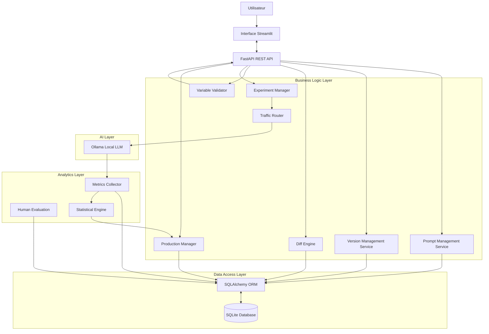

# DOSSIER DE CONCEPTION
## Plateforme de Versionnage de Prompts et d'Expérimentation A/B

**Référence :** CDC-IA-2026-P06  
**Projet :** Prompt Versioning and A/B Testing Platform  
**Version du document :** 1.0  
**Date du document :** in progress  
**Établissement :** CMC  
**Encadrant pédagogique :** Omar Kella  
**Stagiaire 1 :** Ali Ennadafy  
**Stagiaire 2 :** Isaac Smith  

---

# 1. Présentation générale du projet

## 1.1 Contexte

Dans les applications utilisant l'intelligence artificielle générative, les prompts jouent un rôle essentiel dans la qualité des réponses produites par les modèles de langage (LLM).

Cependant, dans de nombreux projets, les prompts sont directement intégrés dans le code source sous forme de chaînes de caractères.

Cette approche présente plusieurs limites :

- Absence d'historique structuré des modifications.
- Difficulté à comparer différentes versions d'un même prompt.
- Risque de perte des anciennes versions.
- Difficulté à mesurer objectivement la qualité des prompts.
- Absence de mécanisme permettant d'identifier automatiquement la meilleure version.

Le projet vise à répondre à ces problématiques à travers une plateforme centralisée de gestion, de versionnage et d'expérimentation des prompts.

## 1.2 Problématique

Comment concevoir une plateforme permettant de versionner les prompts, de comparer différentes versions, de réaliser des expérimentations A/B, de mesurer leurs performances et de promouvoir la variante la plus performante ?

## 1.3 Objectifs du projet

Les objectifs principaux sont :

1. Centraliser les prompts dans un registre unique.
2. Conserver un historique structuré et immuable des versions.
3. Gérer les variables dynamiques dans les prompts.
4. Comparer visuellement deux versions avec un mécanisme Diff.
5. Distribuer les requêtes entre deux variantes A et B.
6. Collecter automatiquement les métriques techniques.
7. Permettre une évaluation humaine à l'aveugle.
8. Comparer statistiquement les performances.
9. Promouvoir une variante gagnante en production.
10. Permettre un rollback vers une version précédente.

## 1.4 Périmètre fonctionnel

### Fonctionnalités incluses

- Registre centralisé des prompts.
- Gestion des versions.
- Historique des modifications.
- Gestion des variables dynamiques.
- Comparateur Diff.
- API REST d'exécution.
- Routage expérimental A/B.
- Collecte des métriques.
- Évaluation humaine à l'aveugle.
- Analyse statistique.
- Promotion et rollback.
- Tableau de bord.

### Fonctionnalités exclues

- Expérimentations complexes avec plus de trois variantes simultanées.
- Intégrations payantes avec des plateformes Cloud d'analytique.
- Gestion multi-organisations avec facturation.
- Systèmes avancés de bandits manchots contextuels.

---

# 2. Architecture technique

## 2.1 Choix technologiques

| Technologie | Utilisation | Justification |
|---|---|---|
| Python | Langage principal | Développement du backend et des traitements |
| FastAPI | Backend / API REST | Exposition des fonctionnalités via HTTP |
| SQLite | Base de données | Stockage local des prompts, versions et expériences |
| SQLAlchemy | ORM | Gestion des modèles et relations de la base |
| Pydantic | Validation | Validation des données entrantes et sortantes |
| Streamlit | Interface utilisateur | Création du tableau de bord |
| SciPy | Analyse statistique | Calcul des tests statistiques |
| Ollama | LLM local | Exécution locale des modèles génératifs |
| Git | Versionnement du code | Traçabilité des modifications du projet |
| Docker | Déploiement | Packaging et exécution de l'application |

Les technologies sont intégrées progressivement selon les phases de développement. FastAPI, SQLite, SQLAlchemy, Pydantic et Python constituent le socle technique de la première phase. Les autres composants seront intégrés au fur et à mesure de l'implémentation des fonctionnalités correspondantes.

## 2.2 Architecture globale

La plateforme adopte une architecture modulaire organisée en plusieurs couches indépendantes. Chaque couche possède une responsabilité spécifique afin de faciliter la maintenance, les tests et l'évolution du système.

Les couches principales sont :

- **Presentation Layer :** interface utilisateur développée avec Streamlit. Elle permet de consulter les prompts, les versions, les expérimentations et les résultats.
- **API Layer :** endpoints REST développés avec FastAPI. Cette couche reçoit les requêtes, valide les données et communique avec les services métier.
- **Business Logic Layer :** contient les règles métier relatives à la gestion des prompts, au versionnage, aux variables dynamiques, aux comparaisons et aux expérimentations A/B.
- **Data Access Layer :** assure les opérations de lecture et d'écriture dans SQLite à travers SQLAlchemy.
- **AI Layer :** assure la communication avec les modèles de langage locaux exécutés via Ollama.
- **Analytics Layer :** collecte les métriques, traite les résultats et réalise les analyses statistiques des expérimentations.

### Diagramme d'architecture

### Description du flux de fonctionnement

Le fonctionnement général de la plateforme suit les étapes suivantes :

1. L'utilisateur interagit avec l'interface Streamlit.
2. L'interface transmet les requêtes à l'API FastAPI.
3. L'API valide les données et appelle le service métier correspondant.
4. Les services métier communiquent avec la base de données via SQLAlchemy lorsque cela est nécessaire.
5. Lors d'une expérimentation A/B, l'Experiment Manager utilise le Traffic Router pour sélectionner une variante.
6. La variante sélectionnée est exécutée à travers le modèle LLM via Ollama.
7. Les résultats sont transmis au Metrics Collector et enregistrés dans la base de données.
8. Le Statistical Engine analyse les résultats afin d'identifier la variante la plus performante.
9. Le Production Manager permet ensuite de promouvoir la variante retenue ou de revenir à une version précédente.

**Remarque :** ce diagramme représente l'architecture cible du système. Tous les composants ne sont pas encore implémentés. Leur intégration sera réalisée progressivement selon les phases de développement.

## 2.3 Organisation des modules

La plateforme est divisée en modules fonctionnels indépendants. Chaque module possède une responsabilité précise et communique avec les autres composants à travers des interfaces définies.

| Module | Responsabilité | État de réalisation |
|---|---|---|
| API | Exposer les endpoints REST et gérer les requêtes HTTP | Implémenté |
| Prompt Management | Créer et consulter les prompts | Implémenté |
| Version Management | Créer et consulter les versions des prompts | Implémenté |
| Variable Validator | Extraire et valider les variables dynamiques | Implémenté |
| Diff Engine | Comparer deux versions d'un prompt | Implémenté |
| Experiment Manager | Créer et gérer les campagnes A/B | À développer |
| Traffic Router | Distribuer les requêtes entre les variantes | À développer |
| Metrics Collector | Collecter les métriques techniques et fonctionnelles | À développer |
| Human Evaluation | Permettre l'évaluation humaine à l'aveugle | À développer |
| Statistical Engine | Analyser statistiquement les résultats | À développer |
| Production Manager | Gérer la promotion et le rollback des versions | À développer |
| Dashboard | Afficher les prompts, les expériences et les résultats | À développer |

### Principe d'organisation

Les modules sont conçus de manière à limiter les dépendances directes entre les composants.

Cette organisation permet :

- De développer et tester chaque module indépendamment.
- De faciliter l'ajout de nouvelles fonctionnalités.
- De réduire les risques de régression.
- De maintenir une séparation claire entre la logique métier, l'accès aux données et l'interface utilisateur.

Les modules déjà implémentés constituent le socle fonctionnel de la plateforme. Les modules restants seront ajoutés progressivement afin d'atteindre l'architecture cible.

---

# 3. Conception de la base de données

## 3.1 Choix de la base de données

SQLite sera utilisée comme système de gestion de base de données relationnelle.

Ce choix répond aux contraintes du projet :

- Fonctionnement local.
- Absence de coût de licence.
- Installation simple.
- Compatibilité avec Python et SQLAlchemy.
- Stockage des données relatives aux prompts, aux versions et aux expérimentations.

SQLAlchemy sera utilisé comme ORM afin de faciliter les interactions entre l'application Python et la base de données relationnelle.

## 3.2 Modèle conceptuel des données

Le modèle de données doit permettre de gérer les différentes entités nécessaires au fonctionnement de la plateforme.

Les principales entités identifiées sont :

- **PromptTemplate :** représente un modèle de prompt identifié par un nom et une description.
- **PromptVersion :** représente une version spécifique d'un template, avec son contenu, son numéro de version, son auteur et les informations relatives à sa création.
- **Experiment :** représente une campagne d'expérimentation A/B associée à un ou plusieurs prompts.
- **ExperimentVariant :** représente une variante utilisée dans une campagne d'expérimentation.
- **ExperimentResult :** conserve les résultats obtenus lors de l'exécution d'une variante.
- **Metric :** stocke les indicateurs permettant d'évaluer les performances des variantes.
- **HumanEvaluation :** conserve les évaluations réalisées par les utilisateurs ou les évaluateurs.

### Relations principales entre les entités

- Un `PromptTemplate` peut posséder plusieurs `PromptVersion`.
- Une `PromptVersion` appartient à un seul `PromptTemplate`.
- Une `Experiment` peut contenir plusieurs `ExperimentVariant`.
- Chaque `ExperimentVariant` référence une version de prompt.
- Une `ExperimentVariant` peut produire plusieurs `ExperimentResult`.
- Les résultats peuvent être associés à des métriques et à des évaluations humaines.

### État actuel du modèle de données

Dans la première phase de développement, les entités `PromptTemplate` et `PromptVersion` constituent le modèle de données effectivement implémenté dans SQLite.

Les entités relatives aux expérimentations, aux variantes, aux résultats, aux métriques et aux évaluations humaines appartiennent au modèle cible. Elles seront ajoutées dans les phases suivantes, en fonction de l'évolution des fonctionnalités.

Cette séparation permet de conserver une cohérence entre la conception globale et l'état réel de l'implémentation.